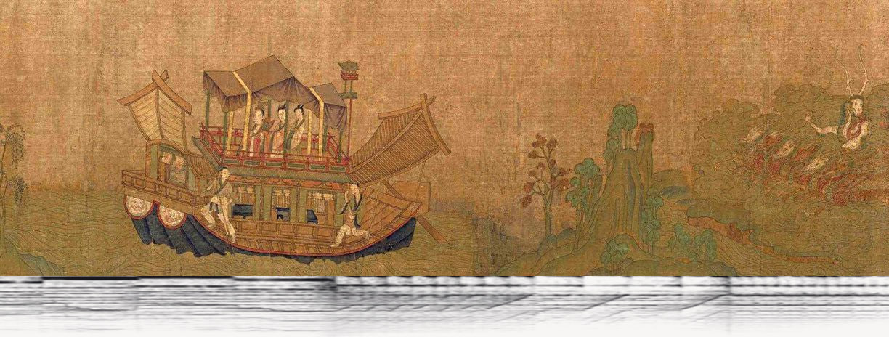
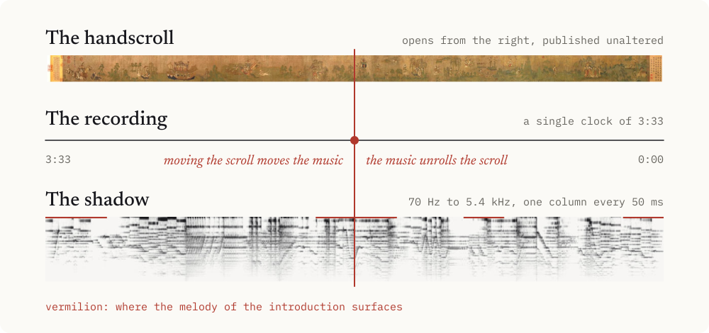
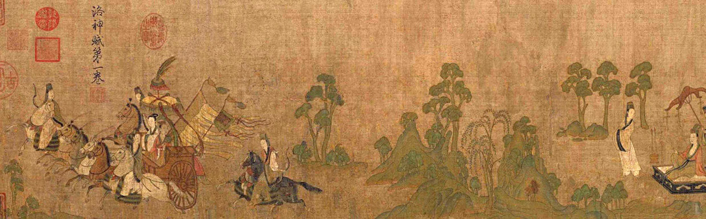
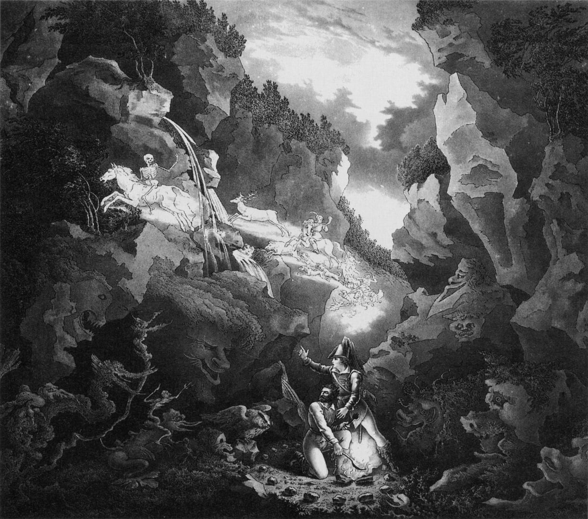

# As If Leaving, As If Returning

若往若还

> "No rule governs the motion, now perilous, now safe. Advance and halt cannot be foretold: as if leaving, as if returning."
>
> Cao Zhi, *Rhapsody on the Goddess of the Luo River*

**A new arrangement of the *Der Freischütz* fantasy, beneath a Song dynasty handscroll that unrolls as you listen, with an essay on beauty across time and aesthetics in the age of AI.**

**[Listen in Chinese](https://www.theodoreoy.com/as-if-returning/)** · **[Listen in English](https://www.theodoreoy.com/as-if-returning/en/)**

I began practicing this fantasy in middle school, and every time I hear it I think something different. It seems always to be leaving and always to be coming back. Cao Zhi gave that motion four characters. This work gives it a form: a melody, a painting, and an essay that keep returning to one another on a single clock.

## One Clock

A handscroll is already a way of keeping time. It opens from the right, one arm's length at a time, and in the *Nymph of the Luo River* the same goddess appears again and again along its length, arriving and receding. A fantasy moves the same way, so I bound the two together. The scroll unrolls across the 3:33 of the recording, and moving the scroll moves the music.

Beneath the painting lies the shadow of the melody, the only new image in the work. It is computed from the recording and drawn as ink, with time running from right to left like the painting above it. A held note becomes a long horizontal stroke, a dense passage gathers into dark wash, and four vermilion marks show where the melody of the introduction surfaces. The painting itself is published unaltered.

## The Arrangement

The melodies began in Weber's opera of 1821 and reached the clarinet in Fritz Kroepsch's fantasy, Op. 6. My arrangement is the next move. It surrounds the line with backing, harmony, and voices, and none of its sound comes from my breath. My work is the arrangement: where the melody stays, what surrounds it, when it steps back.

The melody of the introduction never runs through whole. It enters as soon as the music begins, is easiest to recognize from 0:55 to 1:09, returns after 1:32, and then leaves the surface as the bass grows heavier. In the closing seconds the first notes of the introduction appear, and the piece ends where the introduction begins.

## The Essay

The essay moves between Cao Zhi and Wang Xizhi, Kant, Gadamer, Benjamin, and Kierkegaard, and holds one judgment at its center: AI can read all of the past and has no present of its own. It never leaves, so it cannot return. The weight of beauty comes from human limits: limited time, limited attention, only so many hearings in a life.

*Der Freischütz* is a parable of this. Of the magic bullets, six obey the marksman and the seventh obeys the devil. When we no longer have to complete every note by hand, what remains ours to decide?

## Credits

Plates: *Nymph of the Luo River*, attributed to Gu Kaizhi, Song dynasty copy, Palace Museum, Beijing; Feng Chengsu's Tang dynasty copy of Wang Xizhi's *Orchid Pavilion Preface*, Palace Museum, Beijing; set design for the Wolf's Glen, Weimar, 1822, by Carl Wilhelm Holdermann, Karl Wilhelm Lieber, and Carl August Schwerdgeburth. The works are in the public domain. The scroll is published unaltered; the other plates are only cropped or scaled.

Type: Noto Serif SC and Newsreader, both under the SIL Open Font License 1.1.
